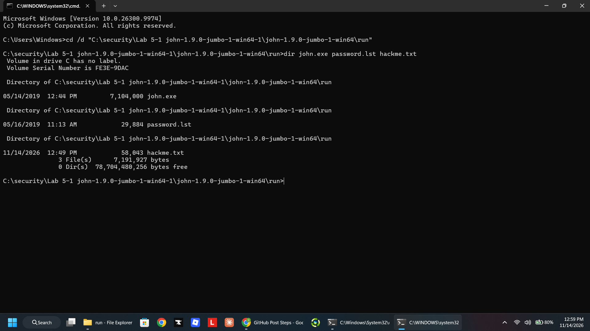
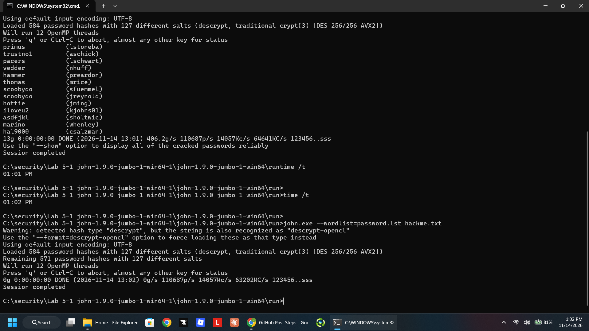
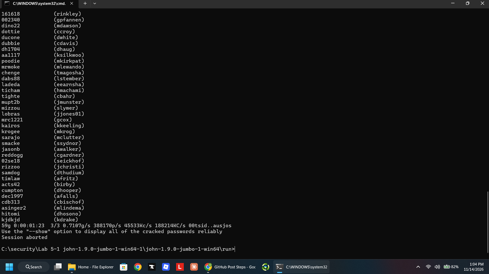

# Password Auditing with John the Ripper

I wanted to see how far I could get with the wordlist that came with John the Ripper. It recovered 13 sample passwords almost immediately. Then I ran John with its default settings and watched the count climb to 59 more before I hit Ctrl+C.

## What I found

- John loaded **584 password hashes** across **127 salts** and identified the format as `descrypt`.
- The built-in wordlist recovered **13 passwords**. Running the same list again recovered **zero** new ones, and John reported **571 hashes remaining** at that point.
- The default run recovered **59 more** in **1 minute and 23 seconds** before I stopped it. That put the two runs at **72 recoveries total**.

## Environment

| Tool or file | What I used it for |
| --- | --- |
| Windows Command Prompt | Ran the audit and checked the output |
| John the Ripper 1.9.0 Jumbo (64-bit) | Loaded the hashes and tested password guesses |
| `hackme.txt` | Sample password hashes supplied for the exercise |
| `password.lst` | The wordlist included with John |

I ran everything locally against the sample data.

## 1. Checking my setup

Before running anything, I used `dir john.exe password.lst hackme.txt` to make sure all three files were in the same `run` folder.



## 2. Trying the built-in wordlist

```cmd
john.exe --wordlist=password.lst hackme.txt
```

This was the result that caught my attention first. The included wordlist was enough to recover 13 passwords. I ran the same command again and got zero new results. Seeing both runs together made it easy to tell what the wordlist had actually added.



## 3. Letting John keep guessing

```cmd
john.exe hackme.txt
```

This time I left the mode unspecified and let John run with its default settings. I stopped it after 1 minute and 23 seconds, when the status line showed `59g`. I checked `john.pot` afterward to see what John had saved. The results screenshots show entries from the sample dataset.



## What I would improve

Next time I'd give each mode the same amount of time and use a separate results file for each run. My second run picked up where the first left off, so these numbers tell me how much the second pass added. With fresh runs, I could compare how much each mode finds on its own.

## What I learned

The part that stuck with me was how much John found before I even changed the settings. I also got into the habit of checking the status line and the saved results. When the terminal scrolls that fast, it's easy to miss what actually happened.

**Tools:** John the Ripper · Windows Command Prompt
